# KV-cache size, attention design and cached-token economics

Date: 2026-11-11. Analysis only: no inference. The only network use was public catalog GETs.

**Code and data:**
- Code: [`experiments/kv_cache_economics_v1.py`](../../experiments/kv_cache_economics_v1.py). Tests: `tests/test_kv_cache_economics.py`, in the portable profile.
- Model configs: copied from the local Hugging Face cache, with snapshot IDs in the file names: `configs/kv_models/`.
- Prices: OpenRouter's public catalog, fetched 2026-11-11: [`openrouter-models-2026-11-11.json`](openrouter-models-2026-11-11.json) and [`openrouter-endpoints-2026-11-11.json`](openrouter-endpoints-2026-11-11.json).
- Each figure has a CSV with the same data. All numbers are in [`results.json`](results.json).

## Model

**Cache bytes per token at context N:**

> c_full + c_window · min(N, W)/N + S/N

- **Full-attention layers** store every token: 2 × KV heads × head dim per layer, or the latent rank + RoPE dimension for MLA.
- **Sliding-window layers** store only the last W tokens.
- **Linear-attention and SSM layers** keep a constant per-sequence state S.
- **Precision:** KV in bf16 (fp8 halves it); recurrent states fp32, convolution states bf16.

**Economics per storage tier:**
- holding cost = bytes × $/GB-hour;
- one-off reload = bytes ÷ bandwidth × GPU $/s, counted as not overlapped, which is conservative;
- recompute = prefill FLOPs ÷ (peak × MFU) × GPU $/s;
- break-even retention = (recompute − reload) ÷ holding rate.

| Assumption | Baseline | Low-cost / high-cost case |
| --- | --- | --- |
| GPU (H100 SXM, 989 TFLOPS bf16, 80 GB HBM) | $2.50/h | $1.50 / $4.00 |
| Prefill MFU | 0.45 | 0.60 / 0.30 |
| HBM holding cost | GPU price ÷ 80 GB | — |
| Host DRAM ($/GB-hour; 50 GB/s to GPU) | 0.001 | 0.0002 / 0.005 |
| NVMe ($/GB-hour; 10 GB/s to GPU) | 3e-5 | 5e-6 / 1.4e-4 |

Active-parameter counts are approximate published figures. These are assumptions, not measurements. Providers using fp8 compute would roughly halve recompute costs.

## Findings

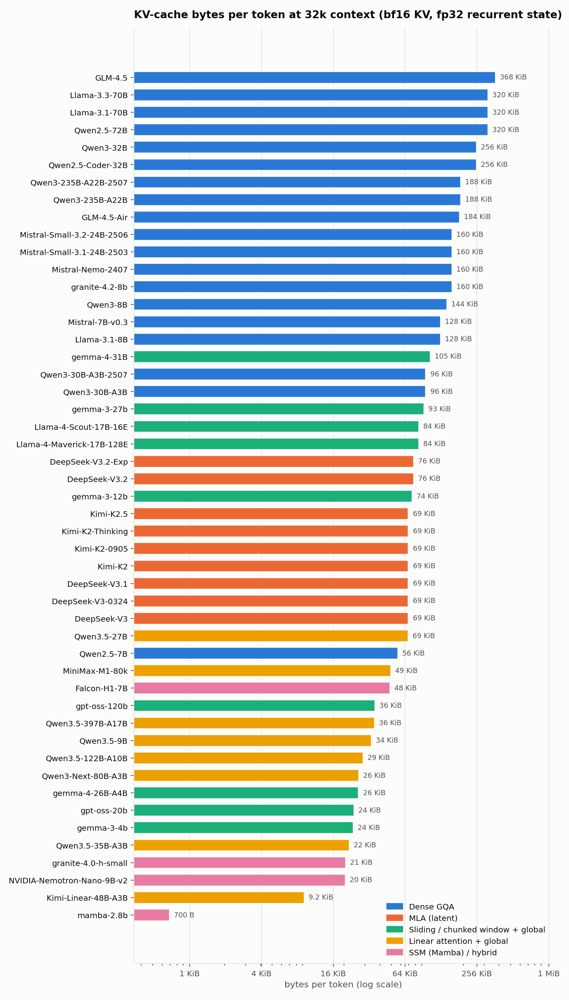

1. **Attention design changes cache size by about 500×.** At 32k context:
   - Dense GQA models need 56–368 KiB per token (Llama 3.3-70B: 320 KiB).
   - MLA keeps DeepSeek-V3/V3.2 and Kimi K2 at 69–76 KiB despite their 600B+ parameters, about 4.5× less than Llama 70B.
   - Sliding-window and linear-attention hybrids are 9–93 KiB. Mamba hybrids are about 20 KiB; pure Mamba-2.8B is 700 B.
   - fp8 KV halves the attention part (Llama 70B: 160 KiB).

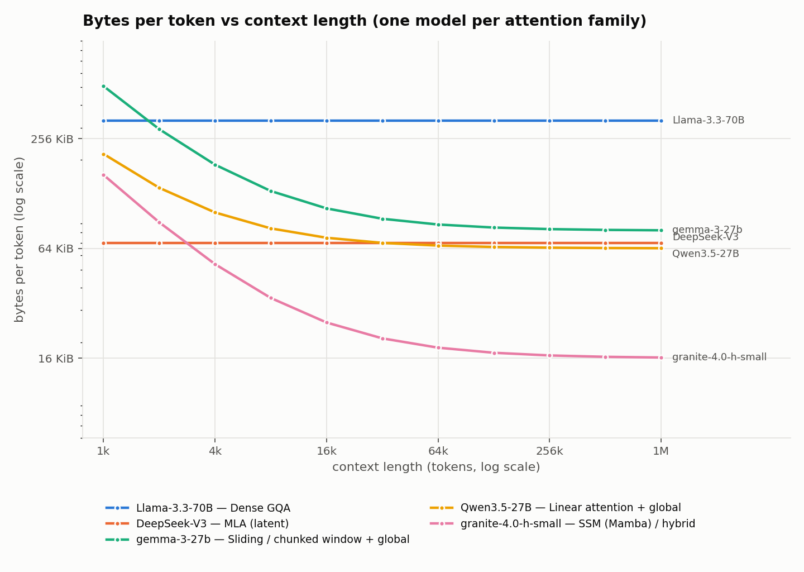

2. **Hybrids are expensive per token for short prompts and cheap for long ones.** Fixed recurrent state (Qwen3.5-27B: 154 MB per sequence; Granite-4.0-H: 153 MB) dominates below a few thousand tokens. At long context only the few global-attention layers count.
   - Gemma 3's 1,024-token window amortizes away by about 64k tokens.
   - Under this model, short-prompt caching on hybrids carries a large fixed state per cached prefix. For SSM layers it also has to be checkpointed at the exact prefix boundary, unlike block-paged KV.

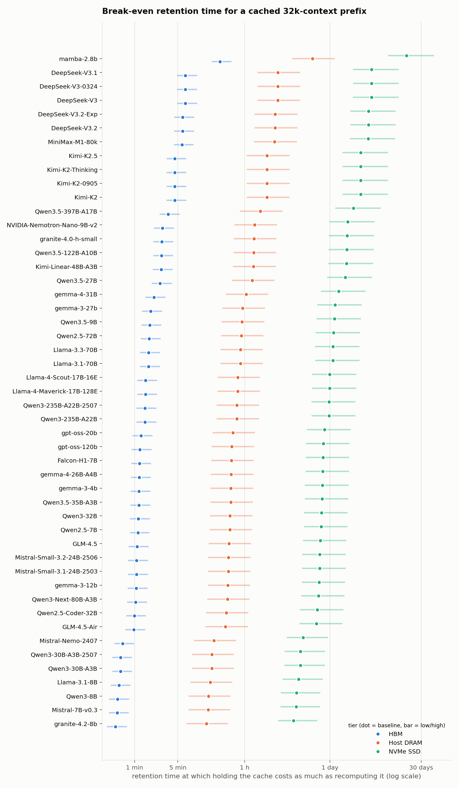

3. **How long caching a 32k prefix pays off, by tier** (baseline; bars show the low/high cases):

   | Tier | Dense models | MLA (DeepSeek-V3) | Mamba-2.8B |
   | --- | --- | --- | --- |
   | HBM | about 0.5–2 min | about 6–7 min | about 24 min |
   | Host DRAM | about 15–50 min | about 3.5 h | — |
   | NVMe | about 7–27 h | about 4–5 days | — |

   Break-even times are fairly similar across models, because recompute cost and cache size both scale with model size. Architectures that shrink the cache relative to compute (MLA, hybrids, MoE with large attention) can afford to cache longer. Provider TTLs of about 5 minutes to 1 hour match the HBM and DRAM tiers. Multi-hour or day-long caching only makes sense on SSD.

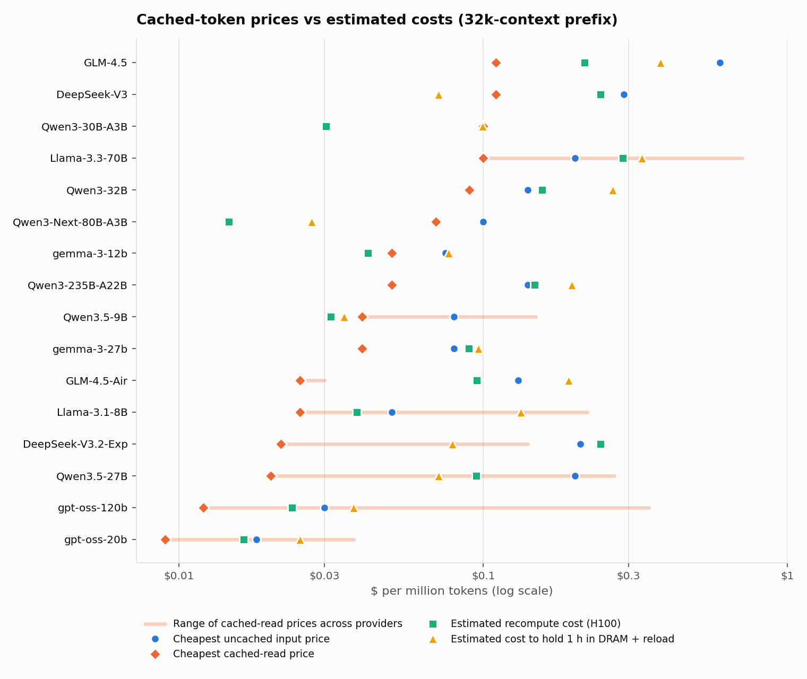

4. **Cached-read prices.** Across 16 models, the cheapest cached-read price is 10–100% of the cheapest uncached input price, with a median of 50%.
   - Some endpoints charge the full input price for cached reads, for example CoreWeave's Llama 3.3-70B and Nebius's Qwen3-30B-A3B.
   - The deepest discounts are DeepSeek-V3.2 (about 10%, GMI Cloud and Baidu) and Qwen3.5-27B (10%, Chutes).
   - Against the baseline recompute estimate, 12 of 16 cheapest cached prices are 0.09–0.65× of recompute cost. The other four are small or sparse models where recompute is already cheap (Qwen3.5-9B, Gemma-3-12B, Qwen3-30B-A3B, Qwen3-Next). There, under our H100 assumption, a cached read costs 1.2–4.8× as much as recomputing.

5. **Reuse needed to cover holding costs.** At the baseline DRAM price, holding a dense model's 32k prefix for an hour costs about as much as 3–8 cached reads at today's cheapest prices (Llama 3.3-70B: 3.3 reads per hour; GLM-4.5-Air: 7.6). Cached-read pricing only covers retention if a prefix is reused several times per hour or evicted quickly, which is consistent with short TTLs. MLA's smaller cache drops DeepSeek-V3 to about 0.65 reads per hour.

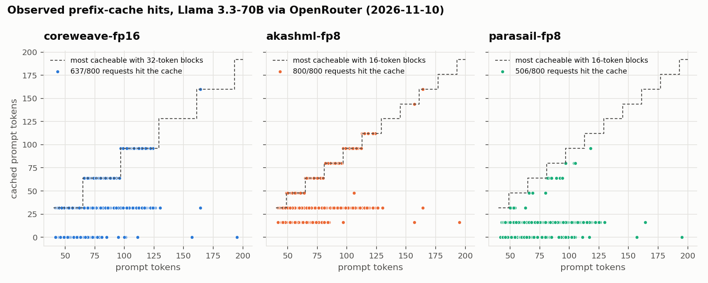

6. **What we observed** (Llama 3.3-70B campaign, 2026-11-10):
   - **Block sizes:** prefix caching works in 32-token blocks on CoreWeave and 16-token blocks on AkashML and Parasail; 16 is vLLM's default.
   - **First vs repeat requests:** the first request for a prompt gets only the shared chat-template header (16 or 32 tokens). The repeat on CoreWeave gets every full block.
   - **Parasail** rarely gets the full prefix on a repeat. That's consistent with requests routed to replicas that don't share a cache, though not established.
   - **SambaNova** reported no cache hits.

## Survey of the most-used open LLMs (added 2026-11-11)

**Model selection** ([`collect_model_configs_v1.py`](../../experiments/collect_model_configs_v1.py), [`kv_cache_survey_v1.py`](../../experiments/kv_cache_survey_v1.py)):
- the 1,000 most-downloaded Hugging Face models across text-generation and image-text-to-text (30-day downloads, excluding test fixtures);
- every OpenRouter model whose catalog entry names a Hugging Face repository.

**Configs:**
- 1,026 of 1,088 configs were retrieved, 281 of them through `base_model` for GGUF-only repositories.
- A general parser classifies each model into seven families: **MHA, GQA, MQA** (dense, by KV-head count), **MLA** (including DSA indexer keys), **sliding / chunked window + global**, **linear attention + global**, and **SSM / conv hybrids**.
- It reproduces all 49 hand-validated models exactly (`tests/test_kv_cache_survey.py`).

Coverage of the top 1,000, by download share:

| Status | Share | Reasons |
| --- | --- | --- |
| Exact | 88.2% | — |
| Approximate | 1.6% | library defaults, per-layer-type heads, MLA with sliding layers |
| Unparsed | 10.3% | 35 configs missing, 16 gated, 18 DeepSeek-V4 compressed KV, 10 non-decoder, 5 draft heads, 3 sparse layouts |

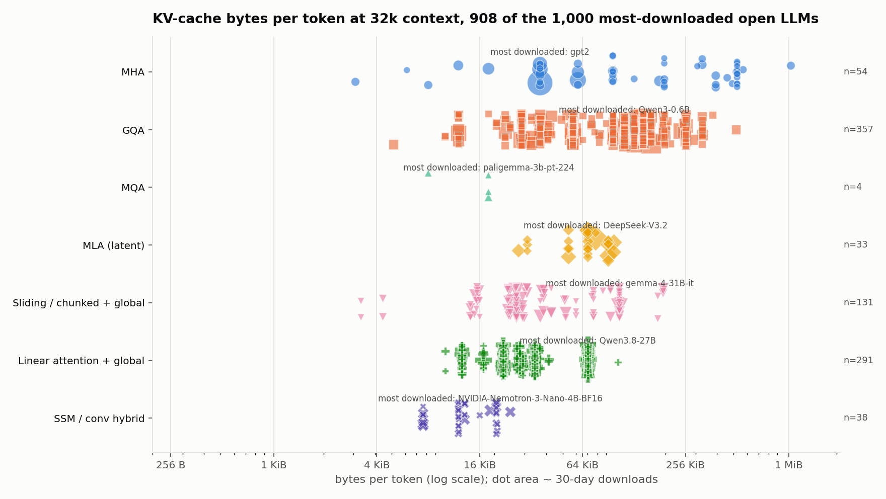

**Which families dominate the most-used models:**
- GQA (357 models) and linear-attention hybrids (291) lead. The latter is mostly the Qwen3.5/3.6/3.8 family and its fine-tunes.
- Sliding/chunked (131), MHA (54, mainly older models such as GPT-2 and Llama 2) and MLA (33) follow. True MQA is rare (4: Falcon-7B, PaliGemma).
- Per-token cache size spans about 1 KiB (small Gemma 3, Mamba) to 1 MiB (GPT-NeoX-20B, 13B MHA Llamas).

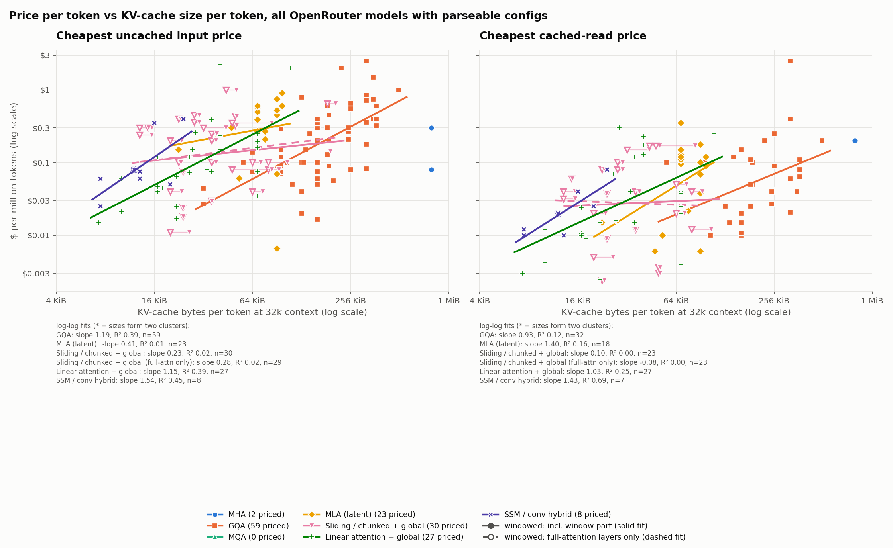

**Price against cache size** (177 OpenRouter models, every family fitted where n ≥ 3; fits in [`fig6_fits.csv`](fig6_fits.csv)):
- GQA, linear hybrids and SSM hybrids show price rising with cache size (uncached slope about 1.2–1.5, R² 0.39–0.45).
- MLA and sliding-window prices are flat against size (R² ≤ 0.02 uncached).
- Excluding the window part does not change the sliding fit.
- MHA (2 priced) and MQA (0) are almost absent from OpenRouter.

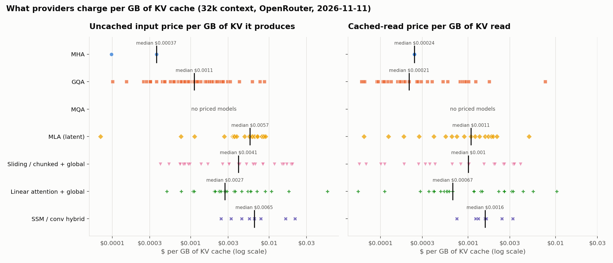

**Price per GB of KV cache** (price per token ÷ bytes per token, at 32k):
- Median cached-read price: about **$0.0002/GB** for GQA, **$0.001/GB** for MLA and sliding window, **$0.0007/GB** for linear hybrids, and **$0.0016/GB** for SSM hybrids.
- Families with small caches charge more per GB, because prices track compute more than cache size.

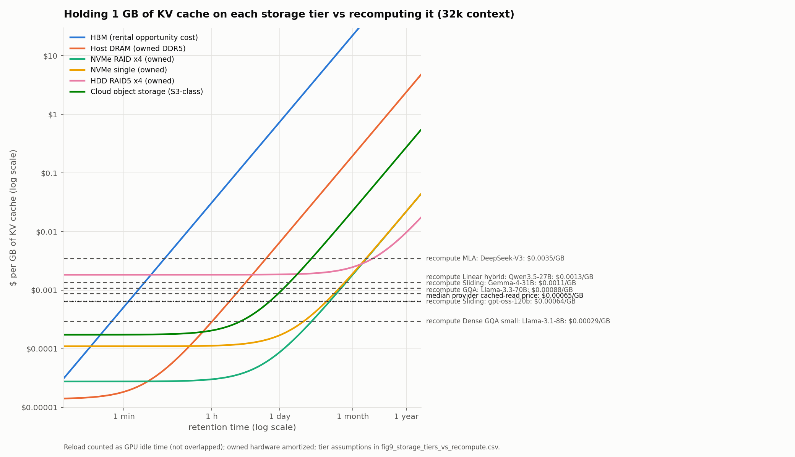

**Storage tiers against recomputation** (per GB of KV, 32k context; assumptions in [`fig9_storage_tiers_vs_recompute.csv`](fig9_storage_tiers_vs_recompute.csv)):

Bandwidths were measured on this workstation with 4 GiB direct-I/O sequential reads: **6.3 GB/s** on a WD SN850X NVMe, and **380 MB/s** on a RAID5 of 4 × Seagate Exos 14–16 TB HDDs that was serving other work. The NVMe RAID figure assumes 4 × 6.3 GB/s.

| Tier | $/GB-hour | Reload $/GB | Break-even (Llama-3.3-70B) | Break-even (DeepSeek-V3) |
| --- | --- | --- | --- | --- |
| HBM (rental opportunity cost) | 3.1e-2 | 0 | about 2 min | about 7 min |
| Host DRAM (owned DDR5, $6/GB, 4 y) | 2.8e-4 | 1.4e-5 | about 3 h | about 12 h |
| Cloud object storage (S3-class) | 3.2e-5 | 1.7e-4 | about 22 h | about 4 days |
| NVMe single (owned, $75/TB, 5 y) | 2.5e-6 | 1.1e-4 | about 13 days | about 55 days |
| NVMe RAID ×4 (owned) | 2.5e-6 | 2.8e-5 | about 14 days | about 57 days |
| HDD RAID5 ×4 (owned, $17.5/TB, 5 y) | 9.0e-7 | 1.8e-3 | **never** | about 75 days |

How to read the HDD row:
- HDD storage is the cheapest per GB-hour.
- But reloading 1 GB at 380 MB/s idles a GPU for about 2.6 s ($0.0018), which already costs more than recomputing the cache for every model except MLA ones.
- HDD arrays only pay off if reloads overlap with other GPU work, or for MLA's compute-heavy cache.

Owned NVMe RAID is the cheapest store for retention of days to weeks. Using rental-price HBM as the holding cost (the framing problem discussed earlier) is what made the earlier HBM figures so short.

## Improvements (2026-11-11): reuse, hybrids, writes, HBM, hardware, confounding, closed providers

### 1. Hybrid models need state checkpoints

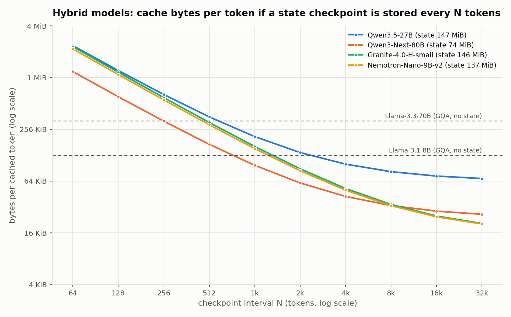

To resume a linear-attention or SSM hybrid from a cached prefix, the server needs the recurrent state at that exact boundary. Checkpointing every N tokens adds `state / N` bytes per token.
- **Qwen3.5-27B** has 154 MiB of state. At 512-token checkpoints that is about 358 KiB per token, more than Llama-3.3-70B's 320 KiB.
- **At 32k-token checkpoints** it falls back to about 69 KiB per token.
- **The earlier per-token figures** (fig1/fig2) assumed one state per sequence. They are lower bounds for prefix caching.
- **In the reuse simulation** (Mooncake conversation trace, NVMe), per-block checkpoints cut Qwen3.5-27B's caching saving from **30% to 1%**.
- **In the retention probe,** the one hybrid endpoint tested (Qwen3.5-397B on DeepInfra) never reported a cache hit.

### 2. Reuse-driven tier economics (Mooncake traces)

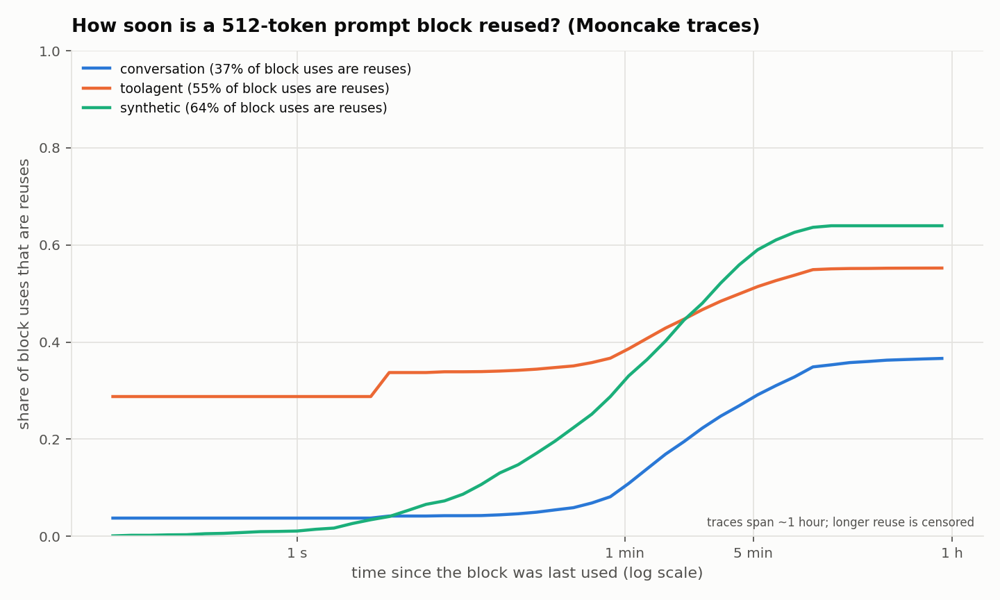

**The traces.** Moonshot's FAST'25 Mooncake traces list 512-token block hashes and timestamps over about an hour. Over that hour:

| Trace | Block uses that are reuses | Reused within 5 min |
| --- | --- | --- |
| conversation | 37% | 29% |
| tool-agent | 55% | 51% (29% within the same instant: concurrent requests sharing a prompt) |
| synthetic | 64% | 59% |

Reuse beyond the 1-hour window is censored.

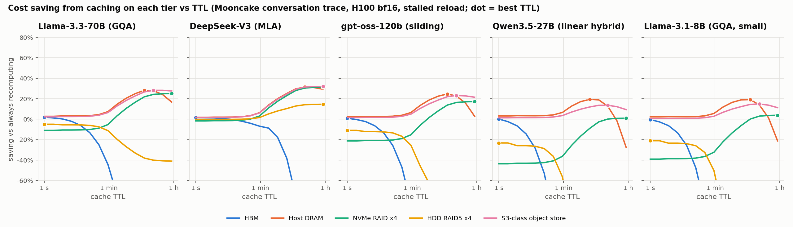

**The simulation** ([`kv_reuse_tiers_v1.py`](../../experiments/kv_reuse_tiers_v1.py), results in [`reuse_tier_results.csv`](reuse_tier_results.csv)):
- Each tier is a cache with a TTL. A hit pays a reload; a miss pays the recompute for that block at its position, plus a write.
- Retained blocks pay holding cost.
- "Don't cache" is allowed and saves 0.

Best savings, against always recomputing (H100 bf16, reload not overlapped):

| Trace | Range across 5 models | Usual best choice |
| --- | --- | --- |
| conversation | 19–32% | host DRAM with a 5–17 min TTL, or S3-class storage with ~17–53 min for the large models |
| tool-agent | 38–47% | host DRAM, 5–17 min |
| synthetic | 52–66% | host DRAM, ~10–17 min |

Further findings:
- **HBM** under full memory pressure (charged at rental share) saves 2% or less. At 10% pressure it saves up to 20% (DeepSeek-V3).
- **HDD RAID** is a loss for every model except DeepSeek-V3 (+15%), because of reload stalls.
- **NVMe** saves 25–31% for large GQA and MLA models, but only 4% for Llama-3.1-8B.

### 3. Measured cache retention at providers

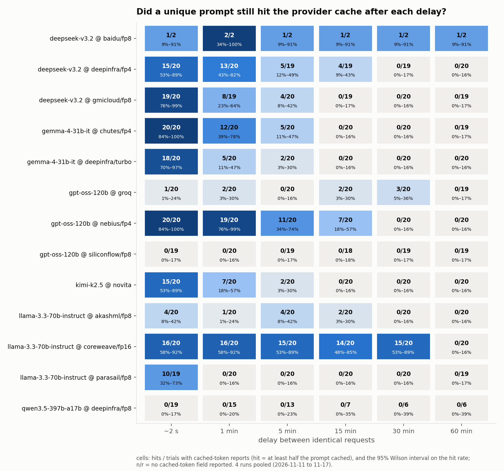

**The probe** ([`cache_ttl_probe_v1.py`](../../experiments/cache_ttl_probe_v1.py), [`cache_ttl_analysis_v1.py`](../../experiments/cache_ttl_analysis_v1.py), 2026-11-11):
- 13 OpenRouter endpoints across 6 models, 312 one-token requests, **$0.154** reported cost.
- Raw evidence: `data/kremlinology-cache-ttl-probe-v1`.
- Each trial sends a unique ~1,530-token prompt (random nonce first) twice, with a delay of 2 s to 60 min between them, 2 replicates per delay.
- A hit means at least half the prompt was reported as cached on the second request.

| Endpoint | Observed retention |
| --- | --- |
| CoreWeave (Llama-3.3-70B), Nebius (gpt-oss-120b) | all hits to 15 min, none at 30 min: **TTL about 15–30 min** |
| DeepInfra (DeepSeek-V3.2) | intermittent to 15 min, none at 30 min |
| GMI Cloud (DeepSeek-V3.2) | to 5 min, none at 15 min |
| Chutes (Gemma 4), Novita (Kimi K2.5), DeepInfra (Gemma 4) | to 1 min, none at 5 min: **about 1–5 min** |
| Parasail (Llama-3.3-70B) | only the immediate resend: **under 1 min** |
| Baidu (DeepSeek-V3.2) | about half the trials hit at every delay up to **60 min**: a long-lived cache not shared across replicas |
| AkashML (Llama-3.3-70B) | misses at 2 s and 1 min, hits at 5–15 min: consistent with asynchronously populated caches (not established) |
| Groq, SiliconFlow (gpt-oss-120b); DeepInfra (Qwen3.5-397B hybrid) | **no hits at any delay**, although Groq lists a cached-read price |

**How this compares with the simulation.** The longest observed TTLs (15–30 min) match the DRAM-tier optimum simulated on the Mooncake traces (5–17 min). Most endpoints keep caches for only minutes, which is HBM-like retention. Two replicates per cell is a small sample: these are retention indications, not measured distributions.

**Update 2026-11-17: four runs pooled, ~20 trials per cell** (v1–v4, [`cache_ttl_probe_v2`–`v4`](../../experiments/cache_ttl_probe_v4.py); v4 tops each cell up to 20; 1,746 more requests, $0.76; figure above regenerated with Wilson 95% intervals). Hits out of trials at 2 s / 1 min / 5 min / 15 min / 30 min / 60 min:

| Endpoint | 2 s | 1 min | 5 min | 15 min | 30 min | 60 min | reading |
| --- | --- | --- | --- | --- | --- | --- | --- |
| CoreWeave (Llama-3.3-70B) | 16/20 | 16/20 | 15/20 | 14/20 | 15/20 | 0/20 | **TTL 30–60 min**; ~1 in 5 repeats misses at any delay (another replica) |
| Nebius (gpt-oss-120b) | 20/20 | 19/20 | 11/20 | 7/20 | 0/20 | 0/20 | decays over 5–30 min |
| DeepInfra (DeepSeek-V3.2) | 15/20 | 13/20 | 5/19 | 4/19 | 0/19 | 0/20 | mostly gone by 5 min, none at 30 |
| GMI Cloud (DeepSeek-V3.2) | 19/20 | 8/19 | 4/20 | 0/19 | 0/20 | 0/19 | 1–5 min |
| Chutes (Gemma 4 31B) | 20/20 | 12/20 | 5/20 | 0/20 | 0/20 | 0/19 | 1–5 min |
| DeepInfra (Gemma 4 31B) | 18/20 | 5/20 | 2/20 | 0/20 | 0/20 | 0/20 | under a minute, mostly |
| Novita (Kimi K2.5) | 15/20 | 7/20 | 2/20 | 0/20 | 0/20 | 0/20 | under a minute, mostly |
| Parasail (Llama-3.3-70B) | 10/19 | 0/20 | 0/20 | 0/20 | 0/20 | 0/19 | **seconds only**, half the repeats |
| AkashML (Llama-3.3-70B) | 4/20 | 1/20 | 4/20 | 2/20 | 0/20 | 0/20 | occasional hits to 15 min |
| Groq (gpt-oss-120b) | 1/20 | 2/20 | 0/20 | 2/20 | 3/20 | 0/19 | scattered (8 of 119): effectively no cache, despite a listed cached price |
| SiliconFlow (gpt-oss-120b) | 0/19 | 0/20 | 0/19 | 0/18 | 0/19 | 0/19 | no cache |
| DeepInfra (Qwen3.5-397B hybrid) | 0/19 | 0/15 | 0/13 | 0/7 | 0/6 | 0/6 | no cache (many 429s at long delays) |
| Baidu (DeepSeek-V3.2) | 1/2 | 2/2 | 1/2 | 1/2 | 1/2 | 1/2 | rate-limited (429) on every top-up: still 2 per cell |

Changes from the 2-replicate table above: CoreWeave keeps prompts for 30 minutes, not 15–30; Nebius and DeepInfra decay gradually instead of holding then dropping; AkashML's "hits only later" pattern was noise (hits are rare at every delay). Baidu's long-lived cache remains untested at n = 2.

### 4. Writes, random reads and endurance

- **NVMe endurance:** writes are charged at drive price ÷ rated endurance ($300 / 2,400 TB written ≈ $0.000125 per GB). That is about 14% of the cost of recomputing a GB of Llama-70B cache, charged on every miss written to SSD.
- **HDD random reads** (direct I/O on this workstation's RAID5): **226 MB/s** at 4 MiB and **430 MB/s** at 16 MiB. 512-token blocks (about 160 MB for Llama-70B) read near the sequential rate; small paged-attention blocks would not.

### 5. HBM marginal cost

HBM is now charged at its rental share times a pressure factor (1 = memory fully contended, 0.1 = mostly idle), shown in the reuse results. At high pressure, longer HBM caching is never worth it. When memory is mostly idle, HBM retention of minutes pays.

### 6. Hardware and precision

Recompute variants (NVMe ×4, conversation trace):
- **H100 fp8 and B200 fp8 compute** cut Llama-3.3-70B's saving from 25% to 15% and 9%. Small, sparse and hybrid models (Llama-8B, gpt-oss, Qwen3.5) **lose money** on NVMe caching.
- **An fp8 KV cache** raises savings: Llama-8B 4% → 19%, Llama-70B 25% → 30%.

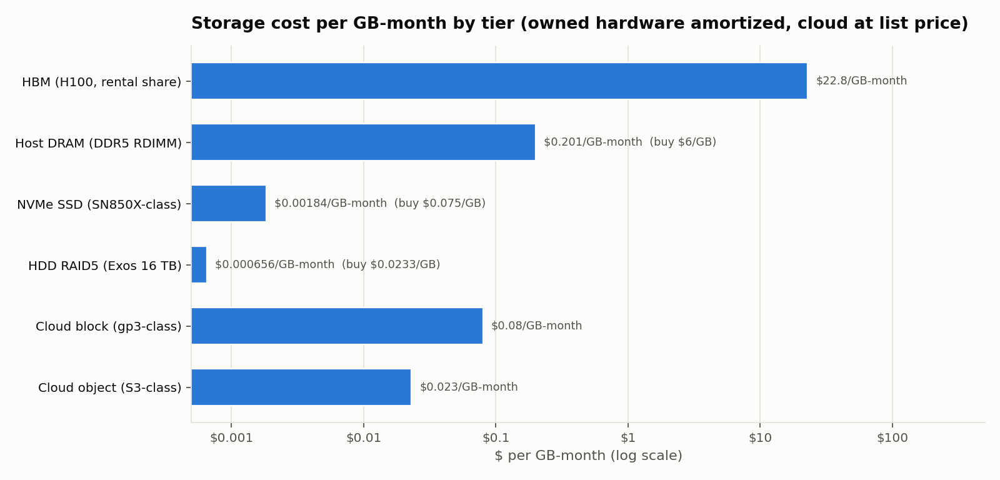

Storage $/GB-month (owned hardware amortized; cloud at list price):

| Tier | $/GB-month |
| --- | --- |
| HBM rental share | $22.8 |
| DDR5 | $0.20 |
| gp3-class block storage | $0.08 |
| S3-class object storage | $0.023 |
| NVMe | $0.0018 |
| HDD RAID5 | $0.00066 |

### 7. Is cache size priced in, holding model size fixed?

Regression: log10 price on log10 estimated active parameters plus log10 KV bytes per token. Active parameters come from a config-based estimator, within 7% median of published counts (49 checks; published counts include embeddings and vision towers).

| Price | n | KV-bytes elasticity (95% bootstrap CI) | Active-params elasticity | R² (with KV / params only) |
| --- | --- | --- | --- | --- |
| cheapest uncached input | 149 | 0.22 (0.06–0.38) | 0.48 (0.35–0.62) | 0.37 / 0.33 |
| cheapest cached read | 109 | 0.38 (0.18–0.57) | 0.27 (0.06–0.46) | 0.23 / 0.15 |

Cache size carries independent weight in prices, and more so for cached reads, consistent with cached-read prices reflecting storage. Most price variation stays unexplained: provider margins, hardware and quantization.

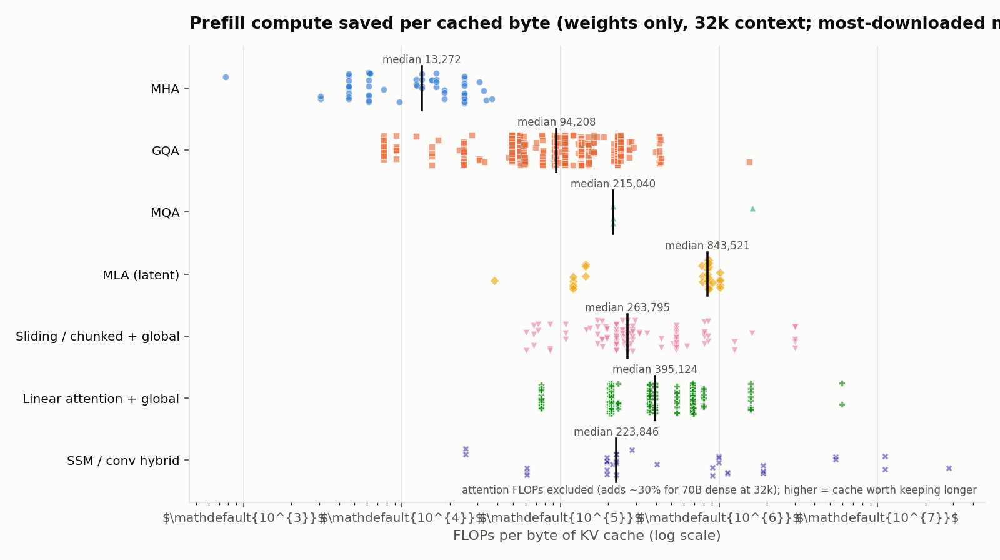

**Compute saved per cached byte.** Median prefill FLOPs (weights only) per byte of 32k cache: MHA 13k, GQA 94k, MQA 215k, SSM hybrids 224k, sliding 264k, linear hybrids 395k (before checkpoints), MLA 844k. Each MLA byte is worth about 9× a GQA byte, so it can be held longer at the same cost.

### 8. Closed providers' cache pricing

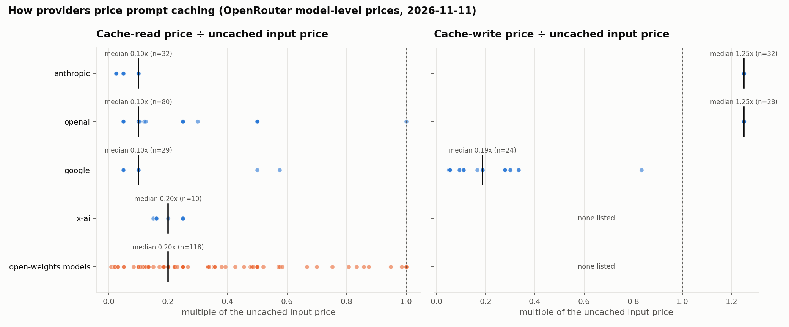

| Provider group | Cache read | Cache write |
| --- | --- | --- |
| Anthropic (n=32) | 0.1× input | 1.25× input |
| OpenAI (n=80) | 0.1× (some up to 0.5×) | 1.25× |
| Google | 0.1× | 0.05–0.83× (median 0.19×) |
| x-ai | 0.2× | none listed |
| Open-weight endpoints (n=118) | 0.2× (median) | none |

These are model-level OpenRouter prices. Google's figures likely reflect storage-based pricing, so treat them as list values only.

### 9–10. Not addressed

- **Usage weighting:** OpenRouter has no public per-model usage API. The survey still weights by Hugging Face downloads.
- **Latency value:** the TTFT saved per hit equals the recompute time (for Llama-70B at 32k, about 13.6 GPU-seconds of prefill), but it isn't priced.

## Limits

- **Single costs only.** No batching interplay, decode costs, cache-management overhead, distributed or network caches, or partial-block waste. HBM holding is charged at a full-GPU share.
- **Recompute uses a single MFU figure** and ignores real attention-kernel efficiency at long context. MLA prefill FLOPs use the non-absorbed form.
- **Prices are list prices** at one point in time. Providers may cache below 32k, at different precisions, or for strategic rather than cost reasons.
- **Provider-specific details are ignored.** State and KV precisions vary by provider (for example fp8 KV caches, or bf16 versus fp32 SSM states).
